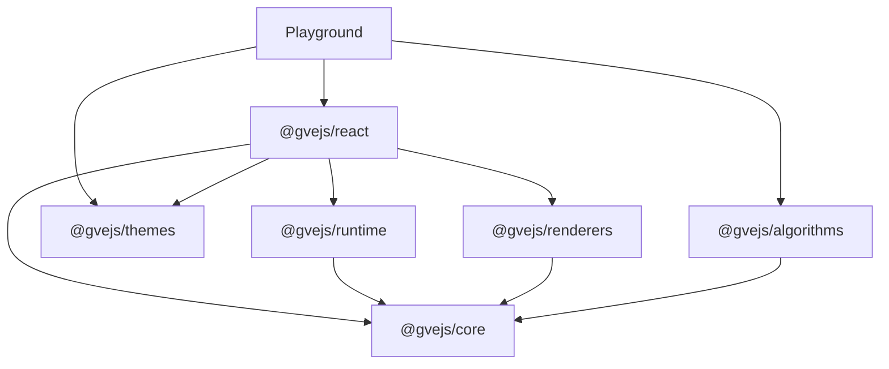

# GeekIsCool Visual Engine

GVE is a TypeScript toolkit for teaching algorithms through deterministic, inspectable visualizations. Algorithms emit typed events, pure reducers turn events into state, and renderers draw that state. The same trace can be saved, replayed, and rendered in different hosts.

## Run the developer portal

Use Node.js 22 and pnpm 10.

```sh
pnpm install
pnpm dev
```

Open the URL printed by Vite for the homepage, documentation, and examples. In the playground, pick an algorithm, edit its JSON input, or use the timeline to inspect a specific step. The catalog includes five sorts, two searches, BFS, DFS, BST insertion, stack operations, and Fibonacci recursion.

## Embed a visualization

The independently packaged ESM libraries use the `@gvejs` scope and declare their dependencies and React peer requirements. For local distribution, run `pnpm build:packages`, then `GVE_PACKAGE_ARTIFACTS=/absolute/path/to/artifacts pnpm verify:packages` to collect six verified tarballs. The first public npm release is version `0.1.0`. Install the React component, algorithm library, and styles with the following command.

```sh
pnpm add @gvejs/react @gvejs/algorithms @gvejs/themes
```

```tsx
import { AlgorithmVisualizer } from '@gvejs/react';
import { bubbleSort } from '@gvejs/algorithms';
import '@gvejs/themes/style.css';

const input = [8, 3, 5, 1, 9];

export function Lesson() {
  return <AlgorithmVisualizer algorithm={bubbleSort} input={input}
    theme="auto" showControls showCode showVariables />;
}
```

[GeekIsCool integration example](examples/geekiscool-embed.tsx)

## Package dependencies

Arrows point from a package to its dependency.



`apps/playground` builds the developer portal, and `apps/docs` contains the repository developer guide. `examples` contains an embeddable lesson, a headless trace replay, and a custom algorithm. `tests` contains the engine suite, browser suite, and benchmark.

## Contributing

1. Add algorithms through the public SDK and write result and trace tests.
2. Run `pnpm format`, `pnpm check`, and `pnpm test:browser` before opening a pull request. Browser tests require `pnpm exec playwright install chromium` and a completed build.
3. Use [Semantic Versioning](https://semver.org/) for package releases. Document any breaking API change and use a new trace schema version when serialized semantics change.

[Portal architecture and deployment](docs/DEVELOPER_PORTAL.md) · [Developer guide](apps/docs/README.md) · [MIT license](LICENSE)

## Release engineering

See the [getting started guide](docs/GETTING_STARTED.md), [public API](docs/API_REFERENCE.md), [architecture](docs/ARCHITECTURE.md), and [algorithm support](docs/ALGORITHM_SUPPORT.md). The [production audit](docs/PRODUCTION_READINESS.md), [performance measurements](docs/PERFORMANCE.md), and [release checklist](docs/RELEASE_CHECKLIST.md) record verification and remaining gates.

[Contributing](CONTRIBUTING.md) · [Security](SECURITY.md) · [Changelog](CHANGELOG.md)
